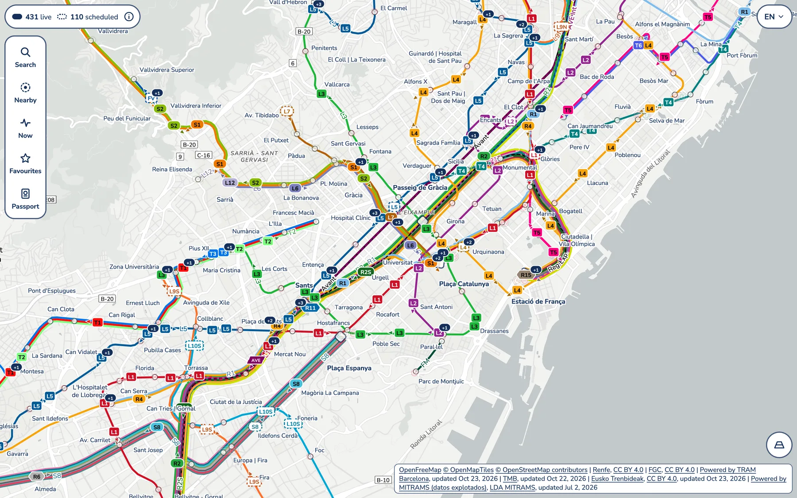
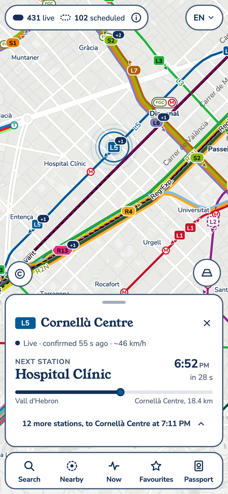
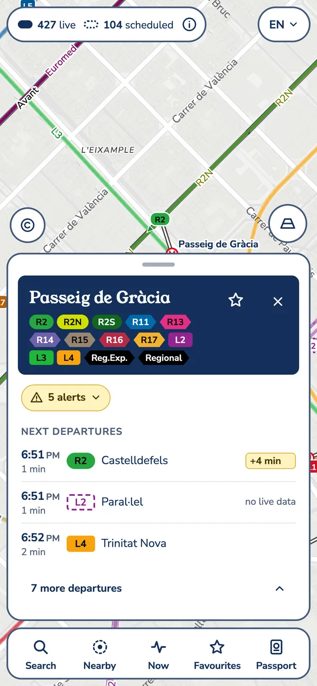
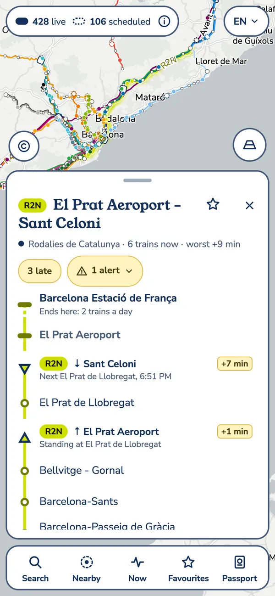
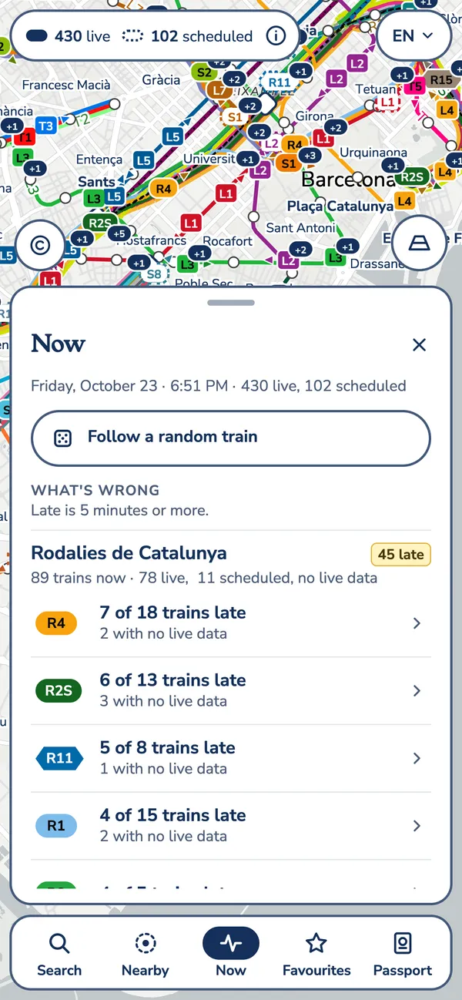
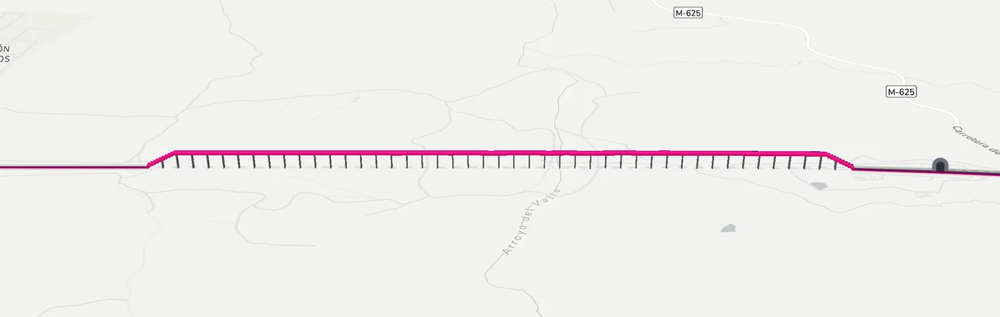
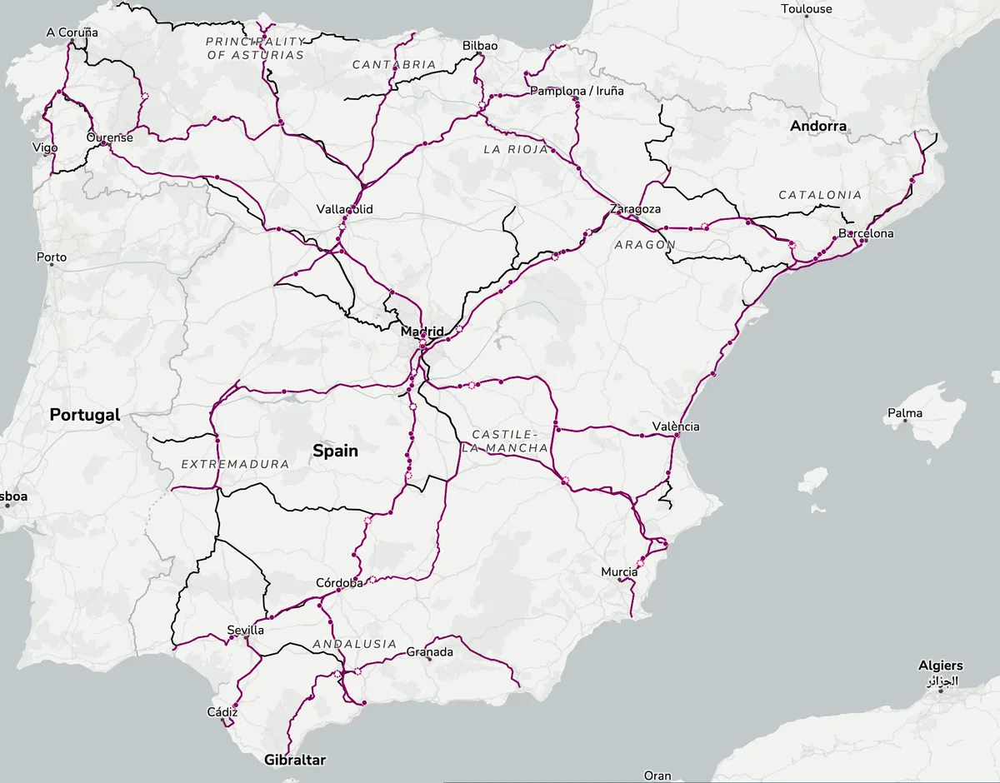
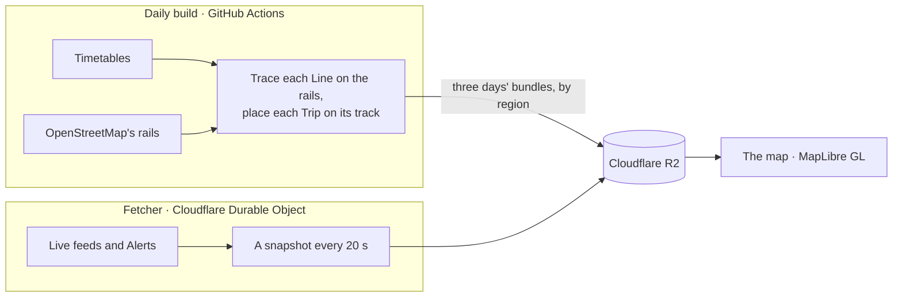

<h1 align="center">Via Península</h1>

<p align="center"><strong>A live map of passenger trains moving on real track across Spain.</strong></p>

<p align="center">
  <a href="https://viapeninsula.gariasf.com"><strong>Open the map</strong></a> ·
  <a href="#what-it-shows">What it shows</a> ·
  <a href="#how-it-works">How it works</a> ·
  <a href="docs/development.md">Development</a>
</p>

<p align="center">
  <a href="https://github.com/gariasf/viapeninsula/actions/workflows/deploy.yml"></a>
  <a href="https://github.com/gariasf/viapeninsula/actions/workflows/daily.yml"></a>
  <a href="LICENSE"></a>
</p>

<a href="https://viapeninsula.gariasf.com">
  <picture>
    <source media="(prefers-color-scheme: dark)" srcset="docs/readme/barcelona-dark.webp">
    
  </picture>
</a>

Each Train on the map is a pill with its Line's name, or zoomed out a dot. Where its operator publishes live data, the Train is drawn where that data puts it, and is Live; where none does, or the data has gone quiet, it runs to its timetable, shifted by its last known Delay, and is drawn dashed as Scheduled. Between reports, Trains keep moving along their track, traced on OpenStreetMap's rails, so they run where they really run rather than in straight lines from Station to Station. Their positions are estimates, built from the operators' timetables and live data.

## What it shows

<table>
  <tr>
    <td width="25%"><picture><source media="(prefers-color-scheme: dark)" srcset="docs/readme/follow-dark.webp"></picture></td>
    <td width="25%"><picture><source media="(prefers-color-scheme: dark)" srcset="docs/readme/board-dark.webp"></picture></td>
    <td width="25%"><picture><source media="(prefers-color-scheme: dark)" srcset="docs/readme/line-dark.webp"></picture></td>
    <td width="25%"><picture><source media="(prefers-color-scheme: dark)" srcset="docs/readme/now-dark.webp"></picture></td>
  </tr>
  <tr>
    <td align="center">Follow a Train</td>
    <td align="center">A Station's board</td>
    <td align="center">A Line</td>
    <td align="center">Now</td>
  </tr>
</table>

- **On the track, side by side.** Each Line is traced along the rails it runs on, and where a region's Lines share track, as Rodalies' do through Barcelona, the map draws them side by side, in one order, as a metro map would.
- **Follow a Train.** Tap one and the map keeps it in view, with a card counting down to its next Station and the rest of its calls.
- **Boards, Lines and Search.** A Station's next departures, those of every Network that meets there on one board; a Line's Trains along its Stations; and Search for a Station, a Line or a Train number.
- **Now and Nearby.** What's wrong at this moment, Network by Network: the Lines with Trains late or cancelled. A Train to follow at random, and the Trains near you.
- **Alerts in the operators' own words.** Renfe's and TRAM's Alerts on the Lines and Stations they name, and Closures drawn on the Lines they close.
- **Favourites and a Passport.** Keep the Stations and Lines you use. Turn the Passport on, and each Train you follow from end to end is a Ride, with a Stamp for each Line, kind of service and Network. Both stay in your browser, with no account and no cookies.
- **3D bridges.** On a desktop, from zoom 14, a Line on a bridge rises onto a deck on piers, and tunnels have mouths.
- **Five languages, light and dark.** Catalan, Spanish, Basque, Galician and English, and the map follows your system's dark mode.

<p align="center">
  <picture>
    <source media="(prefers-color-scheme: dark)" srcset="docs/readme/viaduct-dark.webp">
    
  </picture>
</p>

## Networks

| | Networks | Live data |
|---|---|---|
| **Catalonia** | Rodalies de Catalunya · FGC · Metro de Barcelona · TRAM | Renfe's GPS · FGC's positions · TMB's predictions · TRAM's positions |
| **Cercanías** | Madrid · Asturias · Bilbao · Cádiz · Cartagena · Ferrol · León · Málaga · Murcia/Alicante · San Sebastián · Santander · Sevilla · Valencia · Zaragoza | Renfe's GPS |
| **Basque Country** | Euskotren | Euskotren's trip updates |
| **Long distance** | AVE y Larga Distancia · Media Distancia y Avant · Ouigo | Renfe's GPS; Ouigo publishes none, so its Trains run to their timetable |

Iryo publishes no data on its trains, so they aren't on the map.

<p align="center">
  <picture>
    <source media="(prefers-color-scheme: dark)" srcset="docs/readme/spain-dark.webp">
    
  </picture>
</p>

## How it works



- **The daily build** reads each Network's timetable, traces each of its Lines along OpenStreetMap's rails ([ADR-0004](docs/adr/0004-track-follows-openstreetmap.md)), places every Trip on its track, and publishes the next three service days to R2, in a track file for each region and a Trips file for each region and day ([ADR-0014](docs/adr/0014-the-bundle-is-built-by-region-a-track-file-and-a-trips-file-for-each.md)).
- **The fetcher** reads the operators' live feeds, from every 20 seconds to every 2 minutes as each allows, and writes what they report to one snapshot on R2, with their Alerts beside it ([ADR-0003](docs/adr/0003-live-data-snapshot-on-r2.md)).
- **The map** loads each region's files as it comes into view, and moves every Train along its Trip by its timetable, frame by frame, corrected by each live report as it comes ([ADR-0002](docs/adr/0002-timetable-drives-motion.md)).

It's TypeScript throughout: [MapLibre GL JS](https://maplibre.org) on [OpenFreeMap](https://openfreemap.org)'s basemap, built with Vite and served from Cloudflare Workers.

## Development

You need Node 24 or later, and for the daily build and its tests, `unzip` and osmium-tool (`brew install osmium-tool`).

```sh
npm install
npm run dev     # the site at http://localhost:5173, reading the live data
npm test
npm run check   # typecheck
```

[docs/development.md](docs/development.md) has the rest: the daily build and how to check a change to it, the page harness for browser checks, the fetcher, the Cloudflare setup and the Actions workflows. The domain language is in [CONTEXT.md](CONTEXT.md), the decisions in [docs/adr](docs/adr), the v1 spec in [issue #1](https://github.com/gariasf/viapeninsula/issues/1), and the work is planned in [issues](https://github.com/gariasf/viapeninsula/issues) and [milestones](https://github.com/gariasf/viapeninsula/milestones).

## Licence and credits

The code is [AGPL-3.0](LICENSE). Timetables and live data come from Renfe and FGC under CC BY 4.0, from Eusko Trenbideak through Moveuskadi under CC BY 4.0, from TMB, from TRAM (Powered by TRAM Barcelona), and Ouigo's timetable from the Ministry of Transport's NAP under its LDA MITRAMS licence (Powered by MITRAMS). TMB's and TRAM's terms ask for the day their data was last updated to be shown with it: TMB's feed's start date and, as TRAM's feeds have none, the day the build read them, or where it built them from their copy, the day that was kept. The track follows OpenStreetMap's rails and the basemap comes from OpenFreeMap, both © OpenStreetMap contributors under the ODbL.
